<h1 align="center">
  
</h1>

  

  

  
   
  
   
  
   
  

  

 

  
  
  
  

  
  
  

 

## 🛠️ Tech Stack

  

 

**Open for:** DevOps Roles | Cloud Projects | Collaborations | Content Creation

 

  

  

